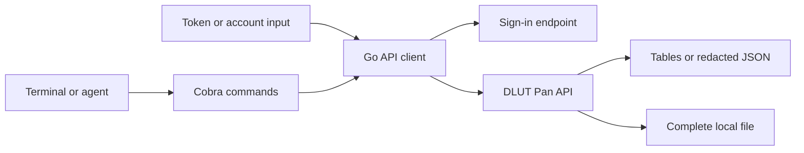

# DLUT Pan CLI

[](https://github.com/saurlax/dlut-pan-cli/actions/workflows/ci.yml)
[](https://go.dev/)
[](LICENSE)

**Dalian University of Technology's cloud drive, from your terminal.**

DLUT Pan CLI is an unofficial Go client for 大工云盘. List course-material
directories, search file names and indexed contents, discover groups, request
membership, and download individual files. Human-readable tables work in a
terminal, while JSON output and request previews support scripts and agents.

The command tree keeps authentication, file operations, search, groups and space
identifiers separate. Every operation has its own help, argument checks and
examples. Credentials stay in the current process and are never persisted.

> **Project status:** The documented sign-in, folder listing, name/full-text/group
> search, group join and file download protocols are implemented and covered by
> local HTTP fixture tests. Live validation with a DLUT account is still needed.
> Upload, delete, move, recursive download, automatic personal-space discovery and
> automated CAS login are not implemented. The documented upstream endpoints use
> HTTP, including query-string credentials; use them only on a trusted network.

## How it fits together

Commands translate arguments into the request formats documented by
[DLUT Skills](https://github.com/NAOSI-DLUT/dlut-skills/tree/main/skills/dlut-pan).
An account login produces an in-memory token for the current operation; an
existing browser token can also be supplied directly.



- **Browse and search.** List one remote directory or fetch one search page.
  Select NAOSI, your personal space, or another group with `--root-id`.
- **Join explicitly.** Search for a group and use its group ID to request
  membership. The CLI never joins groups automatically.
- **Download safely.** Stream a specified file to a staged local file and publish
  it after the transfer succeeds. Existing files require `--overwrite`.
- **Inspect and automate.** Use `--json`, `--dry-run`, standard exit codes and
  Bash, Zsh, Fish or PowerShell completion.

NAOSI is the default space: root `ak7an4chdvtq`, group `ej7f8s176d8f`.
These IDs serve different purposes. Membership and permissions are enforced by
the server; a `403` does not trigger automatic joining or a guessed personal root.

## Run from source

You need **Go 1.26 or later**.

```bash
git clone https://github.com/saurlax/dlut-pan-cli.git
cd dlut-pan-cli
go build -o bin/dlut-pan ./cmd/dlut-pan
./bin/dlut-pan --help
./bin/dlut-pan file list / --username YOUR_STUDENT_OR_STAFF_NUMBER
```

On Windows, build with `go build -o bin/dlut-pan.exe ./cmd/dlut-pan` and run
`.\bin\dlut-pan.exe --help`. The account example prompts for a password without
echoing it. The password and returned token are discarded when the process exits.

To install directly from the repository:

```bash
go install github.com/saurlax/dlut-pan-cli/cmd/dlut-pan@latest
```

Put the Go binary directory on `PATH`. Tagged releases can publish six ZIP
archives for Linux, macOS and Windows on amd64/arm64, with SHA-256 checksums.
See [Releases](https://github.com/saurlax/dlut-pan-cli/releases) for available builds.

For an existing browser session, provide the token through `DLUT_PAN_TOKEN` or
`--token-stdin`. See [authentication](docs/authentication.md) for CAS extraction,
credential precedence, PowerShell examples and the upstream transport constraints.

## Commands

| Command | Purpose |
| --- | --- |
| `auth login` | Verify account credentials; discard the token at process exit |
| `file list [PATH]` | List one directory; default `/` |
| `file download FILE_ID --output FILE` | Download a specified file |
| `search files QUERY` | Search file and directory names |
| `search full-text QUERY` | Search indexed file contents |
| `search groups QUERY` | Find groups without a root ID |
| `group join GROUP_ID --user-id USER_ID --yes` | Join or request membership |
| `space naosi` | Display known NAOSI group/root IDs offline |
| `completion SHELL` | Generate shell completion |

```bash
dlut-pan file list / --json
dlut-pan search files '操作系统' --limit 20
dlut-pan search full-text '编译原理' --path / --offset 20
dlut-pan search groups NAOSI --json
dlut-pan group join ej7f8s176d8f --user-id YOUR_INTERNAL_USER_ID --yes
dlut-pan file download FILE_ID --output lecture.pdf --timeout 10m
dlut-pan search files '课程' --root-id YOUR_PERSONAL_ROOT --dry-run
```

These data commands expect a token in the environment, `--token-stdin`, or account
authentication. Add `--username YOUR_ACCOUNT` to sign in for each invocation.
`auth login` validates credentials but does not establish a saved session.

Use `dlut-pan COMMAND --help` for details, such as
`dlut-pan file download --help`. Running a command group alone displays its help.
The [generated command reference](docs/commands/dlut-pan.md) includes all flags
and shell-specific completion instructions. Exit codes are `0` for success,
`1` for runtime/API errors and `2` for invalid CLI usage.

## Environment variables

| Variable | Purpose | Default |
| --- | --- | --- |
| `DLUT_PAN_TOKEN` | Existing access token | Unset |
| `DLUT_PAN_USERNAME` | Student/staff login account | Unset |
| `DLUT_PAN_PASSWORD` | Account password for this process | Hidden terminal prompt |
| `DLUT_PAN_ROOT_ID` | Selected space root | NAOSI `ak7an4chdvtq` |
| `DLUT_PAN_BASE_URL` | API base URL | `http://pan.dlut.edu.cn/v1` |
| `DLUT_PAN_AUTH_URL` | Full sign-in endpoint | `http://202.118.66.144:8088/v1/auth/sign_in` |

Corresponding flags override environment settings. An explicit `--username` or
`--password-stdin` selects fresh account authentication over an environment token.
`--token-stdin` overrides an environment token. Passwords have no command-line
flag. The CLI does not load `.env` files or maintain a credential store.

## Develop

The project layout follows [autodl-cli](https://github.com/saurlax/autodl-cli).
The README organization follows [AgentCauseway](https://github.com/saurlax/agentcauseway).

```text
cmd/dlut-pan/       Executable entry point and signal handling
internal/api/       HTTP protocol, redaction and staged downloads
internal/cli/       Cobra command tree, help, rendering and validation
internal/config/    Constants and process-local settings
scripts/docs/      Generated command documentation
scripts/package/   Cross-platform ZIP packaging and checksums
docs/              Authentication, API notes and command reference
```

| Work on | Command |
| --- | --- |
| Format | `gofmt -w cmd internal scripts` |
| Static checks | `go vet ./...` |
| Fixture tests | `go test ./...` |
| Race checks | `go test -race ./...` |
| Verify dependencies | `go mod verify` |
| Refresh command help | `go run ./scripts/docs` |
| Build six platforms | `go run ./scripts/package -version dev` |

CI tests on Windows, Linux and macOS, checks generated documentation and builds
all supported targets. A `vMAJOR.MINOR.PATCH` tag runs the same checks and publishes
the generated archives. See [development](docs/development.md) for boundaries and
validation, and [API notes](docs/api.md) for protocol details and known limits.

## Contribute

Bug reports, documentation fixes and focused integrations are welcome. Search
[GitHub Issues](https://github.com/saurlax/dlut-pan-cli/issues) before opening a
proposal. Verify new endpoints before implementing commands and include fixture
tests for their request formats. Never include credentials, private course
materials, or unredacted network captures in reports.

## License

DLUT Pan CLI is licensed under the [MIT License](LICENSE).

Copyright 2026 Saurlax.
